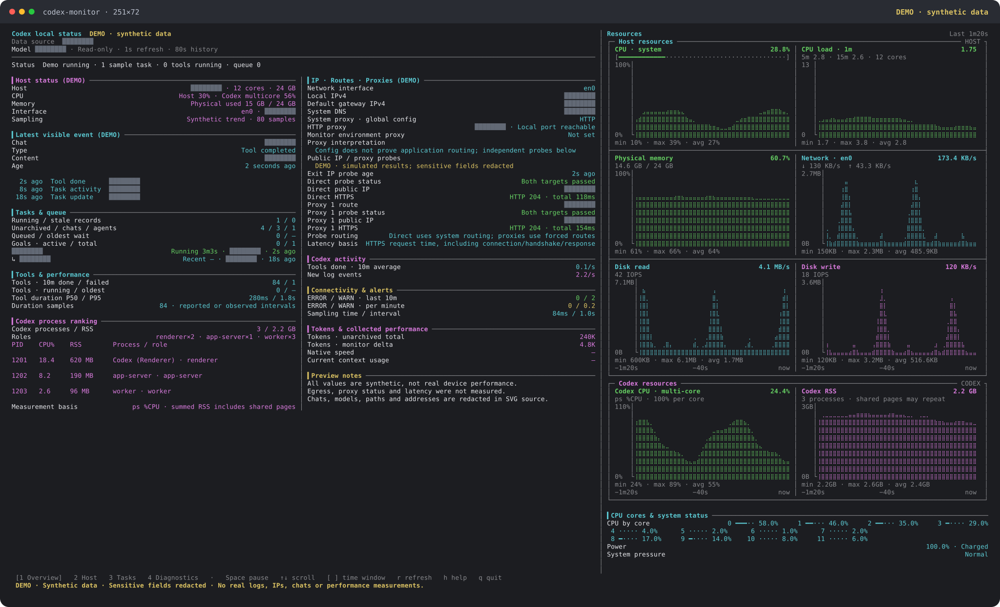

# codex-monitor

[简体中文](README.md) · [繁體中文](README.zh-TW.md) · [English](README.en.md) · [日本語](README.ja.md)

A read-only local Codex terminal dashboard for macOS, with live host resource charts, chat and tool activity, process details, network configuration, and real HTTPS proxy egress checks. No third-party npm runtime dependencies. This is an independent community project, with no official affiliation with OpenAI.



The preview uses **synthetic DEMO data**. Chat names, models, paths, IPs, gateways, DNS, proxy endpoints, and messages are replaced with opaque masks before rendering; original values are absent from the SVG source. Charts, proxy status, and durations are not real measurements or account data. Run `npm run demo` to rebuild all four redacted language previews, or `npm run demo -- --lang en` for English only.

## Install and start

Requires **Node.js 24+**, **macOS**, and **curl 8.7+**. Full host sampling uses system tools including `sysctl`, `top`, `vm_stat`, `memory_pressure`, `route`, `scutil`, `ioreg`, and `pmset`. Some basic metrics may work on other operating systems; full support has not been verified.

Install the command from GitHub:

```sh
npm install --global git+https://github.com/Nemoyuzx/codex-monitor.git
codex-monitor
```

Or clone the repository and link it locally:

```sh
git clone https://github.com/Nemoyuzx/codex-monitor.git
cd codex-monitor
npm link --ignore-scripts
codex-monitor
```

After installation, run `codex-monitor` from any directory. It starts interactive monitoring with a one-second refresh interval, so there is no need to change to the project directory each time.

```sh
codex-monitor -i 3                 # Refresh every three seconds
codex-monitor --view diagnostics   # Open the diagnostics page
codex-monitor --once               # Print one text snapshot
codex-monitor --json --no-probes   # One JSON snapshot without external probes
codex-monitor -w --json            # Stream JSONL snapshots
```

Development tests also require `openssl` and permission to listen on local loopback ports. Tests use temporary files, in-memory databases, and local services; no Codex account or internet connection is required. Node.js 24/26 test jobs are defined in [GitHub Actions](https://github.com/Nemoyuzx/codex-monitor/actions).

There is no standalone desktop app at present. The command requires a terminal and Node.js. Codex's SQLite schema is an internal implementation detail and may change; unreadable fields are shown as unknown.

## Interface languages

The interface supports Simplified Chinese (`zh-CN`), Traditional Chinese (`zh-TW`), English (`en`), and Japanese (`ja`). Help, argument errors, page headings, status messages, and chart labels use the selected language.

```sh
codex-monitor --lang en                  # English
codex-monitor --lang=zh-TW                # Traditional Chinese
codex-monitor --language ja               # Japanese; alias for --lang
CODEX_MONITOR_LANG=zh-CN codex-monitor    # Set a preferred language
codex-monitor --lang auto                 # Detect automatically (the default)
codex-monitor --help --lang en            # English help
```

An explicit `--lang` takes priority. Automatic detection takes the first nonempty value other than `auto` from `CODEX_MONITOR_LANG` → `LC_ALL` → `LC_MESSAGES` → `LANG`. An unsupported value, or no configured value, falls back to English. System tags such as `en_US.UTF-8`, `zh-Hans`, `zh-Hant`, and `ja-JP` are normalized; `C` and `POSIX` use English. An explicitly requested unsupported language is an error.

Only built-in interface text is translated. Chat content and titles, tool names, commands, raw logs, and system-provided values stay unchanged. JSON field names and raw data do not change with the interface language.

## Usage

```sh
node codex-status.mjs                      # One text snapshot
node codex-status.mjs -w                   # Monitor, refreshing every second
node codex-status.mjs -w -i 3              # Refresh every three seconds
node codex-status.mjs --color              # Force colors, including in pipes
node codex-status.mjs --no-color           # Disable colors
node codex-status.mjs -w --view tasks      # Start on the tasks page
node codex-status.mjs -w --window 300      # Five-minute trend window
node codex-status.mjs -w --interface en0   # Use a fixed network interface
node codex-status.mjs --json --no-probes  # JSON without external probes
node codex-status.mjs -w --json            # Stream JSONL
```

The live interface takes inspiration from nvitop and provides Overview, Host, Tasks, and Diagnostics pages. The right side contains eight host/Codex trend charts, plus per-core CPU, power, and system pressure. Task, process, tool, network, alert, and performance details appear on the left. At 180 columns or wider, the left side becomes two columns with a fixed header and synchronized scrolling. On wide terminals the right side takes about 40% of the width.

- Charts fill the available width, with the newest sample on the right. Missing or not-yet-collected samples remain blank.
- Charts grow with the available height, while leaving room for per-core status. Short windows omit supporting text before reducing chart height.
- The default trend window is 80 seconds, or four minutes with `-i 3`. The horizontal axis uses actual sample timestamps.
- Physical memory uses a fixed 0–100% scale and is distinguished from the `memory_pressure` estimate. Host and per-core CPU use differences in cumulative CPU times. Codex CPU uses `ps %CPU`, where one full core is 100%.
- The default network interface follows the system default route, with upload and download shown separately. Block-device I/O includes mounted disk images and does not claim to count only physical disks.
- Below 180 columns, the left side becomes one column. Below 84 columns, right-side charts are hidden; all eight current resource values remain available in the text details. Live mode reserves space for the footer.
- `--window` accepts 10–3600 seconds, and `--threads` accepts 1–30 table entries. The table limit does not restrict background statistics to only the displayed chats.

## Keyboard controls

| Key | Action |
| --- | --- |
| `1` / `2` / `3` / `4` | Overview / Host / Tasks / Diagnostics |
| Space / `p` | Pause or resume sampling; keep the current screen while paused |
| `↑` / `↓`, `k` / `j` | Scroll all left-side content; both columns scroll together |
| `PgUp` / `PgDn`, `g` / `Home` | Page up/down, return to the top |
| `[` / `]` | Shorten or expand the trend window |
| `r` | Sample now and refresh probes and metric snapshots |
| `h` / `?` | Help |
| `q` / `Ctrl-C` | Exit and restore the terminal |

Use `CODEX_HOME` to select a data directory, if needed. The default is `~/.codex`.

```sh
CODEX_HOME=/path/to/.codex codex-monitor
```

## What it monitors

- **Latest visible event:** type, content, timestamp, and elapsed time, with the latest agent and user messages.
- **Unfinished tool calls:** calls without an observed completion, including ongoing turns.
- **Processes, MCP, queue, and goals:** app-server, exec-server, code-mode-host, recognizable MCP subprocesses, cloud queue backlog, and ongoing goals.
- **Network probes:** local IPC, network service status, and reachability of four backend endpoints.
- **Storage, logs, and usage:** cumulative token counters, data/DB/WAL sizes, free disk space, log heartbeat, and an ERROR summary.
- **Conservative status assessment:** a red/yellow/green assessment based on the observed signals above.

Charts and text details cover:

- **Host:** overall/per-core CPU, physical memory, memory-pressure estimates, directional traffic on the selected interface, block-device reads/writes and IOPS, page faults, swap, battery, and system pressure. Charts can show window min/max/average.
- **Codex:** process-tree CPU/RSS, desktop, app-server, exec-server, code-mode, recognizable MCP and worker processes, and a CPU ranking. A process is not classified as a Codex worker merely because its arguments contain “codex.” Summed RSS double-counts shared pages.
- **Tasks:** main chats/subagents, models, run duration, recent activity, stale historical turns, queue count and oldest wait, and goals that are actually active.
- **Tools:** completions and failures in the last 10 minutes/hour, types, running calls, and P50/P95 duration. Completion rate uses actual completion timestamps and is shown as a ten-minute average. Failures are included in total completions.
- **Diagnostics:** HTTP status and response-header latency, per-minute ERROR/WARN averages, logger-target summaries, DB/WAL sizes, free disk space, collection duration, and source availability. HTTP 401/403 responses only prove that a path is reachable; they do not verify login or service health. MCP count alone is not evidence of a leak.
- **Network configuration:** local IPv4/IPv6 on the selected interface, IPv4/IPv6 default gateways, system DNS, HTTP/HTTPS/SOCKS proxies, PAC, auto-discovery and bypass rules, process proxy environment variables, and detected tunnel interfaces. Overview shows a summary; Diagnostics shows full details. A tunnel interface's presence does not prove that a VPN carries the traffic.
- **Measured egress:** public IP, real HTTPS reachability, HTTP status, and request duration for direct routing and each explicitly selected proxy. Authentication, TCP/DNS/proxy handshake/TLS/timeout failures are distinguished. Partial target reachability is labeled. Press `4` for timing stages and path-verification details.
- **Tokens:** database cumulative counters and changes since monitoring began. These are not model generation speeds.

## Optional native performance snapshots

If a compatible Codex Usage Badge `thread-metrics.sqlite` already exists locally, the monitor reads input/output values, TTFT, cache-hit metrics, and approximate native speed for the displayed chat UUID. Use `--metrics-db PATH` to specify a compatible database. The interface shows available integrated fields with their collection time and labels old snapshots as cached.

`≈tok/s` requires native samples with complete observation metadata. It is not estimated from cumulative tokens or whole-turn duration. Unknown context ratios, GPU/temperature values without a reliable source, and other unavailable metrics stay blank. The monitor does not read login credentials or start an additional native event listener.

## Public IP and real proxy checks

System `curl` sends separate HTTPS requests using direct routing, system HTTP/HTTPS/SOCKS settings, and proxy environment variables. Identical endpoint/authentication pairs are deduplicated, with at most four proxies tested. Credentials are passed only through child-process standard input, never arguments, JSON, or logs.

- **[ipify public IP service](https://www.ipify.org/):** requests `https://api.ipify.org?format=json`. Egress is shown only for HTTP 200 with a valid public IP.
- **[HTTPS reachability target](https://www.gstatic.com/generate_204):** succeeds only for HTTP 204 with an empty response. It is reported separately from the IP lookup, so a restriction on one target is not mistaken for total proxy failure.
- Explicit proxy requests must use that proxy. Probes ignore bypass rules and never fall back to direct routing on failure. Both HTTP CONNECT and SOCKS paths carry real HTTPS requests with TLS verification enabled. HTTP 403/407, redirects, HTML, and unexpected responses are not successes. See [curl proxy documentation](https://curl.se/docs/manpage.html#--proxy) and [bypass rules](https://curl.se/docs/manpage.html#--noproxy).
- “Direct (system route)” disables explicit application-level proxies while still following system TUN/VPN routes. Different paths can share one public IP; matching IPs do not prove a proxy was bypassed. Unresolved PAC scripts are labeled and are not treated as verified routes.
- DNS, TCP, TLS, first-byte, and total durations are cumulative from the start of a request. They are neither ICMP ping nor a pure proxy-node RTT. Actual measurement times are retained, and old results are labeled while a refresh is running.
- External checks run as one background batch at a time and are cached for 60 seconds; `r` refreshes them. A batch has at most ten requests, four concurrent requests, and a five-second timeout per request. One-shot text and JSON wait for the bounded batch. Watch mode continues to refresh; exit cancels outstanding requests.

These requests contact only the public services above and carry no Codex sessions or local state. `--no-probes` disables public IP/proxy HTTPS checks and all four application HTTP probes.

## Implementation notes

Local data access is read-only: SQLite read-only connections, configuration reads, and process/disk queries do not modify Codex data. By default the monitor contacts four application endpoints and the two egress-check services above, without uploading local Codex data. `--no-probes` disables all external requests.

- The four application HTTP probes run in the background and cache results for ten seconds. Public IP/proxy checks cache results for 60 seconds; one-second screen refreshes do not send a new request each tick.
- Network configuration is cached for ten seconds and can be refreshed with `r`. Configuration sampling includes TCP listener status for local proxy ports; actual proxy usability is determined separately by real HTTPS checks. Configuration, listening ports, and independent probes do not establish the Codex application's own request path.
- Proxy environment values and PAC URLs show only scheme, host, and port, omitting credentials, paths, and query parameters. `NO_PROXY` shows only the bypass-rule count.
- Data-directory size (`du`) is collected once. One full `ps` collection is shared per tick.
- Database sources are checked every five seconds, so databases created after startup, version rotations, and replaced files are picked up automatically. Press `r` to rediscover sources and reread configuration immediately. Connections remain read-only; unavailable sources stay blank.
- Activity queries reuse prepared statements within one sample. Schema changes invalidate cached columns. Recent-turn queries can use an existing source time index without adding indexes to the source.
- The default network interface follows routing with its own one-second cache. Unknown default routes stay unknown rather than being guessed from cumulative traffic. Refreshes requested during a probe batch are coalesced into one follow-up batch.
- Exit cancels an unfinished `top` sample. Missing or reset counters and changed log sources do not become fake zero rates. Compound emoji in task names are truncated and wrapped as complete characters.
- Timestamps are converted according to their units: `threads.updated_at_ms` and `thread_items.*_at_ms` use milliseconds; `thread_turns.started_at` and `logs.ts` use seconds.
- Tool statistics cover chats updated in the past hour and all candidate ongoing turns, up to 256 chats and 10,000 projected items per chat. Duration percentiles use at most 2,000 sampled completions with real durations. Queries cache results for at least five seconds. Reaching a cap displays “bounded sample” and `≥`; such results cannot establish that every tool is healthy.
- Failed SQL queries or missing sources produce unavailable/empty values, rather than zero usage, zero alerts, or a healthy status. Historical unfinished calls are listed separately; age over one hour alone does not prove that they stopped.
- JSON/JSONL contains resource values, chat metadata, and numerical statistics. It omits messages, tool-command arguments, log bodies, and identity credentials.
- Watch mode restores raw mode, line wrapping, cursor visibility, and the alternate screen on exit or collection errors. Non-TTY and JSONL output do not send screen-control sequences.

Run validation:

```sh
npm run check
npm test
```

## Privacy and sharing

Terminal pages can display local conversation excerpts. JSON omits message and command bodies but still includes chat titles/nicknames, UUIDs, models, IP addresses, and proxy endpoints. Review and redact screenshots and exported files before sharing. Do not commit real Codex databases, authentication files, private conversation screenshots, or network captures.

## Contributing and license

[Issues](https://github.com/Nemoyuzx/codex-monitor/issues) and focused improvements are welcome. See [CONTRIBUTING.md](CONTRIBUTING.md) for development conventions. Licensed under the [MIT License](LICENSE).

Interface reference: [nvitop's host panel](https://github.com/XuehaiPan/nvitop/blob/main/nvitop/tui/screens/main/panels/host.py).
