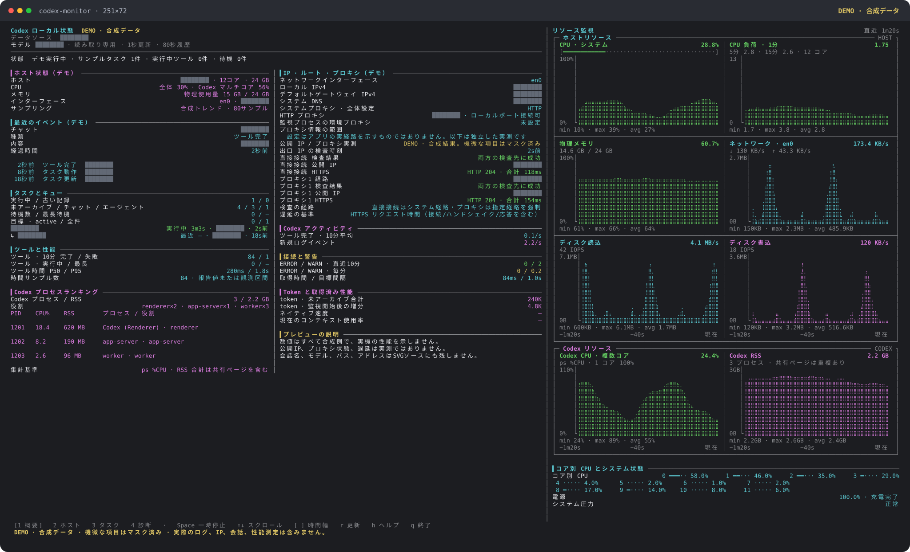

# codex-monitor

[简体中文](README.md) · [繁體中文](README.zh-TW.md) · [English](README.en.md) · [日本語](README.ja.md)

macOS 向けの、ローカル Codex の状態を読み取り専用で表示するターミナルダッシュボードです。ホストリソースのリアルタイムグラフ、チャットとツールの動作、プロセス、ネットワーク設定、実際の HTTPS リクエストによるプロキシ出口の確認をまとめて表示します。実行時にサードパーティー製 npm パッケージは不要です。OpenAI との公式な関係はない、独立したコミュニティプロジェクトです。



プレビューは **合成 DEMO データ**です。会話名、モデル名、ローカルパス、IP アドレス、ゲートウェイ、DNS、プロキシのエンドポイント、メッセージは、描画前に不透明なマスクへ置き換えており、元の値は SVG のソースにも残しません。リソースグラフ、状態、所要時間もすべて模擬データで、実アカウントのスクリーンショットでも、実測した性能データでもありません。`npm run demo` で 4 言語すべてのプレビューを、`npm run demo -- --lang ja` で日本語版だけを再生成できます。

## インストールと起動

**Node.js 24+**、**macOS**、**curl 8.7+** が必要です。ホスト情報の完全な収集には、`sysctl`、`top`、`vm_stat`、`memory_pressure`、`route`、`scutil`、`ioreg`、`pmset` などのシステムツールを使用します。他の OS でも一部の基本指標を取得できる可能性はありますが、完全な動作は検証していません。

GitHub からコマンドをインストールします。

```sh
npm install --global git+https://github.com/Nemoyuzx/codex-monitor.git
codex-monitor
```

または、リポジトリをクローンしてローカルでリンクします。

```sh
git clone https://github.com/Nemoyuzx/codex-monitor.git
cd codex-monitor
npm link --ignore-scripts
codex-monitor
```

インストール後は、どのディレクトリからでも `codex-monitor` で起動できます。既定では 1 秒ごとに更新する対話モードになるため、毎回プロジェクトのディレクトリへ移動する必要はありません。

```sh
codex-monitor -i 3                 # 3 秒ごとに更新
codex-monitor --view diagnostics   # 診断ページを開く
codex-monitor --once               # テキストのスナップショットを 1 回出力
codex-monitor --json --no-probes   # 外部への疎通確認なしで JSON を 1 回出力
codex-monitor -w --json            # JSONL を継続出力
```

開発用テストには、追加で `openssl` とローカルのループバックポートをリッスンできる権限が必要です。テストには一時ファイル、インメモリデータベース、ローカルサービスを使用し、Codex アカウントやインターネット接続は必要ありません。Node.js 24/26 のテストジョブは [GitHub Actions](https://github.com/Nemoyuzx/codex-monitor/actions) に定義しています。

現時点では単体のデスクトップアプリはありません。コマンドの実行にはターミナルと Node.js が必要です。Codex の SQLite スキーマは内部実装であり、今後変更される可能性があります。読み取れない項目は不明として表示します。

## 表示言語

簡体字中国語（`zh-CN`）、繁体字中国語（`zh-TW`）、英語（`en`）、日本語（`ja`）に対応しています。ヘルプ、引数エラー、ページ見出し、状態メッセージ、グラフのラベルに選択した言語を使用します。

```sh
codex-monitor --lang en                  # 英語
codex-monitor --lang=zh-TW                # 繁体字中国語
codex-monitor --language ja               # 日本語。--language は --lang の別名
CODEX_MONITOR_LANG=zh-CN codex-monitor    # 優先する言語を指定
codex-monitor --lang auto                 # 自動判定（既定）
codex-monitor --help --lang en            # 英語のヘルプ
```

明示的な `--lang` の指定を優先します。自動判定では、`CODEX_MONITOR_LANG` → `LC_ALL` → `LC_MESSAGES` → `LANG` の順に、空でも `auto` でもない最初の値を使用します。その値が未対応の場合、または値が設定されていない場合は英語になります。`en_US.UTF-8`、`zh-Hans`、`zh-Hant`、`ja-JP` などのシステムの言語タグも正規化します。`C` と `POSIX` は英語です。未対応の言語を明示的に指定した場合はエラーになります。

翻訳するのは組み込みの画面テキストだけです。チャット本文とタイトル、ツール名、コマンド、生ログ、システムから返された値は変更しません。JSON のフィールド名と生データも表示言語によって変わりません。

## 使い方

```sh
node codex-status.mjs                      # テキストを 1 回出力
node codex-status.mjs -w                   # 1 秒ごとに監視・更新
node codex-status.mjs -w -i 3              # 3 秒ごとに更新
node codex-status.mjs --color              # パイプ出力でも色を有効にする
node codex-status.mjs --no-color           # 色を無効にする
node codex-status.mjs -w --view tasks      # タスクページから開始
node codex-status.mjs -w --window 300      # 直近 5 分間の推移
node codex-status.mjs -w --interface en0   # ネットワークインターフェースを固定
node codex-status.mjs --json --no-probes  # 外部への疎通確認なしで JSON を出力
node codex-status.mjs -w --json            # JSONL を継続出力
```

リアルタイム画面は nvitop のターミナルレイアウトを参考にしており、概要、ホスト、タスク、診断の 4 ページがあります。右側にはホストと Codex の 8 つの推移グラフに加え、コア別 CPU、電源、システムプレッシャーを表示します。タスク、プロセス、ツール、ネットワーク設定、警告、性能の詳細は左側に配置しています。ターミナル幅が 180 桁以上になると左側が 2 列になり、ヘッダーを固定したまま両列が一緒にスクロールします。横長のターミナルでは、右側が画面幅の約 40% を使用します。

- グラフは利用可能な幅いっぱいに表示し、最新のサンプルを右端に置きます。欠測や未収集の区間は空白にします。
- 利用可能な高さに合わせてグラフを拡大し、コア別の状態を表示する余地も確保します。高さが足りない場合は、グラフを縮める前に補足テキストを省きます。
- 既定の推移期間は 80 秒です。`-i 3` では 4 分間になります。横軸には実際のサンプル時刻を使用します。
- 物理メモリの目盛りは 0–100% に固定し、`memory_pressure` による推定値とは区別します。ホスト全体とコア別の CPU 使用率には累積 CPU 時間の差分を使用します。Codex CPU は `ps %CPU` の値で、1 コアを完全に使用した状態が 100% です。
- 既定のネットワークインターフェースはシステムのデフォルトルートに追従し、送信と受信を別々に表示します。ブロックデバイス I/O にはマウントしたディスクイメージも含まれ、物理ディスクだけの集計ではありません。
- 幅が 180 桁未満では左側が 1 列になります。84 桁未満では右側のグラフを非表示にしますが、8 項目の現在値はテキストの詳細で確認できます。リアルタイムモードではフッターのための領域を確保します。
- `--window` は 10–3600 秒、`--threads` は表の表示件数として 1–30 件を指定できます。表の表示上限によって、バックグラウンドの統計対象が表示中のチャットだけに制限されることはありません。

## キーボード操作

| キー | 操作 |
| --- | --- |
| `1` / `2` / `3` / `4` | 概要 / ホスト / タスク / 診断 |
| Space / `p` | 収集を一時停止・再開。一時停止中は現在の画面を保持 |
| `↑` / `↓`、`k` / `j` | 左側の内容全体をスクロール。2 列表示では両列が連動 |
| `PgUp` / `PgDn`、`g` / `Home` | ページ単位で移動、先頭へ戻る |
| `[` / `]` | 推移グラフの期間を短縮・拡大 |
| `r` | すぐに収集し、疎通確認と数値スナップショットも更新 |
| `h` / `?` | ヘルプ |
| `q` / `Ctrl-C` | 終了してターミナルの設定を復元 |

必要に応じて `CODEX_HOME` でデータディレクトリを指定できます。既定は `~/.codex` です。

```sh
CODEX_HOME=/path/to/.codex codex-monitor
```

## 監視できる内容

- **最後に確認できたイベント：** 種類、内容、時刻、経過時間と、最新のエージェントメッセージ・ユーザーメッセージ。
- **完了を確認できていないツール呼び出し：** 進行中のターンを含め、対応する完了が観測されていない呼び出し。
- **プロセス、MCP、キュー、目標：** app-server、exec-server、code-mode-host、識別可能な MCP 子プロセス、クラウドキューの滞留、進行中の目標。
- **ネットワークの疎通確認：** ローカル IPC、ネットワークサービスの状態、4 つのバックエンドエンドポイントへの到達性。
- **ストレージ、ログ、使用量：** 累積トークン数、データ・DB・WAL のサイズ、ディスク空き容量、ログの更新時刻、ERROR の集計。
- **観測範囲に基づく状態判定：** 上記の情報をもとに、赤・黄・緑で控えめに評価。

グラフとテキストの詳細には次の項目を含みます。

- **ホスト：** 全体・コア別 CPU、物理メモリ、メモリプレッシャーの推定値、選択したインターフェースの送受信、ブロックデバイスの読み書きと IOPS、ページフォルト、スワップ、バッテリー、システムプレッシャー。グラフには表示期間の最小・最大・平均値を表示できます。
- **Codex：** プロセスツリーに基づく CPU/RSS の集計、デスクトップ、app-server、exec-server、code-mode、識別可能な MCP とワーカープロセス、CPU 使用率の順位。引数に「codex」が含まれるだけのプロセスを Codex ワーカーとして扱いません。RSS の合計には共有ページの重複を含みます。
- **タスク：** メインチャット・サブエージェント、モデル、実行時間、最近の動作、過去から残っているターン、キュー件数と最長待ち時間、実際に active な目標。
- **ツール：** 直近 10 分・1 時間の完了件数と失敗件数、種類、実行中の呼び出し、所要時間の P50/P95。完了率は実際の完了時刻で集計した 10 分間の平均です。失敗も完了総数に含みます。
- **診断：** HTTP ステータスとレスポンスヘッダー受信までの時間、1 分あたりの ERROR/WARN 平均、logger target 別の集計、DB/WAL サイズ、ディスク空き容量、収集時間、データソースの利用可否。HTTP 401/403 が返っても、経路への到達性を示すだけで、ログインやサービスの正常動作を証明するものではありません。MCP の数だけでリークと判定しません。
- **ネットワーク設定：** 選択したインターフェースのローカル IPv4/IPv6、IPv4/IPv6 のデフォルトゲートウェイ、システム DNS、HTTP/HTTPS/SOCKS プロキシ、PAC、自動検出・バイパス規則、現在のプロセスのプロキシ環境変数、検出したトンネルインターフェース。概要には要約、診断には詳細を表示します。トンネルインターフェースの存在だけで、VPN にトラフィックが流れているとは判断しません。
- **出口の実測：** 直接接続と明示的に指定した各プロキシの公開 IP、実際の HTTPS 到達性、HTTP ステータス、リクエスト所要時間。認証、TCP/DNS/プロキシハンドシェイク/TLS/タイムアウトの失敗を区別します。一部の接続先だけに到達できる場合も明示します。`4` で段階別の時間と経路確認の詳細を表示します。
- **トークン：** データベースの累積カウンターと、監視開始後の増分。モデルの生成速度を表す値ではありません。

## 任意のネイティブ性能スナップショット

互換性のある Codex Usage Badge の `thread-metrics.sqlite` がすでにローカルにある場合、表示中のチャット UUID に対応する入力・出力の値、TTFT、キャッシュヒットの指標、ネイティブ計測による概算速度を読み取り専用で取得します。`--metrics-db PATH` で互換データベースを指定できます。実装済みで取得できる項目だけを収集時刻とともに表示し、古いスナップショットにはキャッシュであることを示します。

`≈tok/s` には、完全な観測メタデータを持つネイティブサンプルが必要です。累積トークン数やターン全体の所要時間からは推定しません。不明なコンテキスト使用率、信頼できる取得元がない GPU・温度など、取得できない指標は空欄にします。ログイン認証情報の読み取りや、追加のネイティブイベントリスナーの起動は行いません。

## 公開 IP と実際のプロキシ接続確認

システムの `curl` で、直接接続、システムの HTTP/HTTPS/SOCKS 設定、プロキシ環境変数に対して、それぞれ別の HTTPS リクエストを送信します。同一のエンドポイント・認証情報の組み合わせは重複を除き、最大 4 つのプロキシを確認します。認証情報は子プロセスの標準入力だけに渡し、引数、JSON、ログには含めません。

- **[ipify 公開 IP サービス](https://www.ipify.org/)：** `https://api.ipify.org?format=json` にリクエストします。HTTP 200 で有効な公開 IP が返った場合だけ出口を表示します。
- **[HTTPS 到達性の確認先](https://www.gstatic.com/generate_204)：** HTTP 204 でレスポンスが空の場合だけ成功とします。IP の取得とは別に結果を表示し、一方の接続先の制限をプロキシ全体の障害と誤認しないようにします。
- 明示的なプロキシへのリクエストは、指定したプロキシの使用を強制します。バイパス規則は無視し、失敗しても直接接続へ切り替えません。HTTP CONNECT と SOCKS のどちらも、TLS 検証を有効にして実際の HTTPS リクエストを送ります。HTTP 403/407、リダイレクト、HTML、想定外のレスポンスは成功としません。[curl のプロキシ仕様](https://curl.se/docs/manpage.html#--proxy)と[バイパス規則](https://curl.se/docs/manpage.html#--noproxy)を参照してください。
- 「直接接続（システムルート）」はアプリケーション層の明示的なプロキシを無効にしますが、システムの TUN/VPN ルートには従います。異なる経路が同じ公開 IP を使う場合もあるため、IP が一致するだけではプロキシを通っていないと判断できません。未解決の PAC スクリプトはその旨を表示し、確認済みの経路として扱いません。
- DNS、TCP、TLS、最初のバイト、全体の時間は、すべてリクエスト開始からの累積時間です。ICMP ping や純粋なプロキシノードの RTT ではありません。実際の測定時刻を保持し、再確認中に表示する古い結果は前回の結果として明示します。
- 外部への確認処理はバックグラウンドで同時に 1 バッチだけ実行し、結果を 60 秒間キャッシュします。`r` で更新できます。1 バッチは最大 10 リクエスト、同時実行数 4、各リクエストのタイムアウトは 5 秒です。単発のテキスト・JSON 出力では、この上限付きのバッチが終わるまで待ちます。監視モードでは画面更新を継続し、終了時に未完了のリクエストを取り消します。

これらのリクエストは上記の公開サービスだけに接続し、Codex のセッションやローカル状態を送りません。`--no-probes` は、公開 IP・プロキシの HTTPS 確認と、4 つのアプリケーション HTTP 疎通確認をすべて無効にします。

## 実装上の注意

ローカルデータへのアクセスはすべて読み取り専用です。SQLite の読み取り専用接続、設定ファイルの読み取り、プロセス・ディスクの照会で Codex のデータを変更しません。既定では 4 つのアプリケーションエンドポイントと上記 2 つの出口確認サービスに接続しますが、Codex のローカルデータはアップロードしません。`--no-probes` で外部リクエストをすべて無効にできます。

- 4 つのアプリケーション HTTP 疎通確認はバックグラウンドで実行し、結果を 10 秒間キャッシュします。公開 IP・プロキシの確認は 60 秒間キャッシュするため、画面を 1 秒ごとに更新しても毎回リクエストを送りません。
- ネットワーク設定は 10 秒間キャッシュし、`r` で更新できます。設定の収集ではローカルのプロキシポートの TCP リッスン状態も確認しますが、実際の使用可否は独立した HTTPS の実測で判断します。設定、ポートのリッスン状態、独立した疎通確認は、Codex アプリ自身のリクエスト経路を証明するものではありません。
- プロキシ環境変数と PAC の URL はスキーム、ホスト、ポートだけを表示し、認証情報、パス、クエリパラメーターを省きます。`NO_PROXY` はバイパス規則の件数だけを表示します。
- データディレクトリのサイズ（`du`）は 1 回だけ収集します。各更新では `ps` による全プロセスの収集結果を共有します。
- データベースの取得元を 5 秒ごとに再確認するため、起動後に作られたデータベース、バージョン切り替え、ファイルの置き換えにも自動で追従します。`r` を押すと取得元を再検出し、設定も直ちに読み直します。接続は常に読み取り専用で、利用できない取得元の値は空欄にします。
- 動作統計のクエリでは、1 回の収集内でプリペアドステートメントを再利用します。スキーマが変わると列情報のキャッシュを無効にします。最近のターンを取得するクエリは、元のデータベースに既存の時刻インデックスがあれば利用し、インデックスを追加することはありません。
- デフォルトのネットワークインターフェースは独立した 1 秒間のキャッシュでルートに追従します。デフォルトルートが不明な場合は不明のままとし、累積トラフィックから推測しません。疎通確認の実行中に更新要求があった場合は、後続の 1 バッチにまとめます。
- 終了時には未完了の `top` 収集を取り消します。カウンターの欠落・リセットやログ取得元の変更を、偽のゼロレートとして表示しません。タスク名に含まれる複合絵文字は、文字のまとまりを壊さずに省略・折り返します。
- タイムスタンプは項目ごとに単位を変換します。`threads.updated_at_ms` と `thread_items.*_at_ms` はミリ秒、`thread_turns.started_at` と `logs.ts` は秒です。
- ツール統計は、直近 1 時間に更新されたチャットと、進行中と考えられるすべての候補ターンを対象とし、最大 256 チャット、各チャット最大 10,000 件の対象項目を取得します。所要時間の分位数には、実際の所要時間がある完了サンプルを最大 2,000 件使用します。クエリ結果は最低 5 秒間キャッシュします。上限に達すると「上限付きサンプル」と `≥` を表示するため、その結果だけで全ツールが正常だと判断することはできません。
- SQL クエリの失敗やデータソースの欠落は、利用不可・空欄として表示し、使用量ゼロ、警告ゼロ、正常状態とは扱いません。過去の未完了呼び出しは別に列挙し、1 時間以上経過したことだけでは停止したと判断しません。
- JSON/JSONL にはリソース値、チャットのメタデータ、数値統計を含めます。メッセージ本文、ツールコマンドの引数、ログ本文、認証情報は含めません。
- 監視モードでは、終了時や収集エラー時に raw モード、行の折り返し、カーソル表示、代替画面を元に戻します。非 TTY と JSONL の出力には画面制御シーケンスを送りません。

検証を実行するには：

```sh
npm run check
npm test
```

## プライバシーと共有

ターミナルのページには、ローカルの会話の抜粋が表示されることがあります。JSON はメッセージとコマンドの本文を省きますが、チャットのタイトル・ニックネーム、UUID、モデル、IP アドレス、プロキシのエンドポイントなどは含みます。スクリーンショットやエクスポートしたファイルを共有する前に内容を確認し、機密情報をマスクしてください。実際の Codex データベース、認証ファイル、私的な会話のスクリーンショット、ネットワークキャプチャーをコミットしないでください。

## 貢献とライセンス

[Issue](https://github.com/Nemoyuzx/codex-monitor/issues) の報告や、目的を絞った改善を歓迎します。開発時の規約は [CONTRIBUTING.md](CONTRIBUTING.md) を参照してください。[MIT License](LICENSE) で公開しています。

画面の参考：[nvitop のホストパネル](https://github.com/XuehaiPan/nvitop/blob/main/nvitop/tui/screens/main/panels/host.py)。
