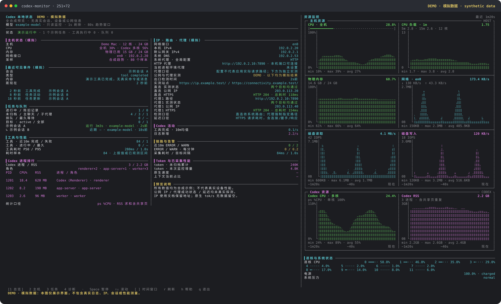

# codex-monitor

[简体中文](README.md) · [English](README.en.md)

只读的本地 Codex 终端监控台：主机资源、聊天与工具活动、进程、网络及真实代理出口检测。独立社区项目，与 OpenAI 无官方隶属关系。

Read-only local Codex terminal dashboard for macOS. Live resource charts, activity summaries, and real HTTPS proxy egress checks, with no third-party npm runtime dependencies.



预览中的会话、IP 和资源曲线均为模拟数据，可用 `npm run demo` 重建；不是实际性能测量或真实账号截图。

## 安装与启动

需要 **Node.js 24+**、**macOS** 和 **curl 8.7+**。主机完整采样依赖系统自带的 `sysctl`、`top`、`vm_stat`、`memory_pressure`、`route`、`scutil`、`ioreg`、`pmset` 等工具。其他系统的部分基础指标可能可用，完整支持尚未验证。

从 GitHub 安装命令：

```sh
npm install --global git+https://github.com/Nemoyuzx/codex-monitor.git
codex-monitor
```

或者克隆后在本机链接：

```sh
git clone https://github.com/Nemoyuzx/codex-monitor.git
cd codex-monitor
npm link --ignore-scripts
codex-monitor
```

安装后可在任意目录直接输入 `codex-monitor`，默认进入每秒刷新的交互模式。无需每次切换到项目目录。

```sh
codex-monitor -i 3                  # 每 3 秒刷新
codex-monitor --view diagnostics    # 诊断页
codex-monitor --once                # 单次文字输出
codex-monitor --json --no-probes    # 单次 JSON，不访问外部探针
codex-monitor -w --json              # 持续 JSONL
```

开发测试另外需要 `openssl`、本地回环端口监听权限。所有测试使用临时文件、内存数据库或本机服务，不要求 Codex 账号，也不依赖公网。Node 24/26 的自动测试见 [GitHub Actions](https://github.com/Nemoyuzx/codex-monitor/actions)。

当前版本还没有独立桌面应用；命令需要终端和 Node.js 运行时。SQLite 数据结构属于 Codex 内部实现，后续版本可能变化，无法读取的字段会显示未知。

## 界面语言

支持简体中文（`zh-CN`）、繁體中文（`zh-TW`）、English（`en`）和日本語（`ja`）。帮助、参数错误、页面标题、状态提示和图表标签随所选语言切换：

```sh
codex-monitor --lang en                  # 英语
codex-monitor --lang=zh-TW                # 繁体中文
codex-monitor --language ja               # 日语；--language 是 --lang 的别名
CODEX_MONITOR_LANG=zh-CN codex-monitor    # 用环境变量固定简体中文
codex-monitor --lang auto                 # 自动选择（默认）
codex-monitor --help --lang en            # 英语帮助
```

显式 `--lang` 优先。自动选择按 `CODEX_MONITOR_LANG` → `LC_ALL` → `LC_MESSAGES` → `LANG` 取第一个非空、非 `auto` 的值；未设置或该值不受支持时使用英语。兼容 `en_US.UTF-8`、`zh-Hans`、`zh-Hant` 和 `ja-JP` 等系统语言标记；`C` / `POSIX` 使用英语。显式指定不支持的语言会报错，不会悄悄改用其他语言。

只翻译内置界面文字。聊天内容、标题、工具名、命令、原始日志和系统返回值保留原样，JSON 字段名与原始数据不随界面语言变化。

## 用法

    node codex-status.mjs              # 单次输出
    node codex-status.mjs -w           # 实时刷新（默认每 1 秒）
    node codex-status.mjs -w -i 3      # 每 3 秒刷新
    node codex-status.mjs --color      # 强制彩色（管道时也输出颜色）
    node codex-status.mjs --no-color   # 关闭颜色
    node codex-status.mjs -w --view tasks       # 从任务页启动
    node codex-status.mjs -w --window 300       # 最近 5 分钟趋势
    node codex-status.mjs -w --interface en0   # 固定网络接口
    node codex-status.mjs --json --no-probes   # JSON 快照，关闭全部外部探针
    node codex-status.mjs -w --json           # 持续输出 JSONL

实时模式参考 nvitop 的终端布局，提供总览、主机、任务、诊断四页。右侧展示 8 张主机/Codex 趋势图，以及逐核 CPU、电源和系统压力；任务、进程、工具、网络配置、告警和性能详情都在左侧。终端达到 180 列时，左侧自动分成两栏，头部固定、两栏正文同步滚动。宽屏右栏约占 40%，其余宽度留给左侧信息。

- 图表占满可用宽度，最新采样位于最右侧；缺失或尚未采集的数据留空。
- 图表按可用高度放大，不再为文字列表压缩；右侧会为逐核状态留出空间。较矮窗口优先省略辅助文字、再缩小图高。
- 默认时间窗口为最近 80 秒；`-i 3` 时为最近 4 分钟，横轴按实际采样时间绘制。
- 物理内存固定为 0–100%，与 `memory_pressure` 的估计明确区分；全机/逐核 CPU 使用累计时间差分，Codex CPU 为 `ps %CPU`（单核 100%）。
- 默认网络接口跟随系统默认路由，分别展示上传/下载。块设备 IO 包含挂载镜像，不声称仅统计物理硬盘。
- 终端宽度不足 180 列时，左侧合并为单栏；不足 84 列时隐藏右侧图表，8 项资源当前值仍在文字详情中可见。实时刷新为底部提示保留空间。
- `--window` 支持 10–3600 秒，`--threads` 支持 1–30 个表格条目，均不限制后台统计只扫描所显示的聊天。

## 快捷键

| 按键 | 操作 |
| --- | --- |
| `1` / `2` / `3` / `4` | 总览 / 主机 / 任务 / 诊断 |
| 空格 / `p` | 暂停或恢复采样，暂停期间保留当前画面 |
| `↑` / `↓`、`k` / `j` | 滚动左侧完整内容，宽屏两栏同步滚动 |
| `PgUp` / `PgDn`、`g` / `Home` | 翻页、回到顶部 |
| `[` / `]` | 缩短或扩大趋势时间窗口 |
| `r` | 立即采样并刷新探针和数值快照 |
| `h` / `?` | 帮助 |
| `q` / `Ctrl-C` | 退出并恢复终端 |

可选：用 CODEX_HOME 指定数据目录（默认 ~/.codex）。

    CODEX_HOME=/path/to/.codex node codex-status.mjs -w

## 监控维度

- [1] 最近一次可见事件：类型 / 内容 / 时间 / 距现在（附最近智能体与用户消息）
- [2] 有没有工具调用没看到完成输出（含进行中的 turn）
- [3] 进程 · MCP · 队列 · 目标：app-server / exec-server / code-mode-host、可辨 MCP 子进程数、云端队列积压、进行中目标
- [4] 网络探针：本地 IPC、网络服务、4 个后端连通性
- [5] 存储 · 日志 · 用量：累计 token、数据目录/DB/WAL 大小、磁盘剩余、日志心跳与 ERROR 摘要
- [6] 当前状态的保守判断：综合以上做红/黄/绿定级

右侧趋势图和左侧详情包括：

- 主机：全机与逐核 CPU、物理内存、内存压力估计、默认接口的分方向流量、块设备读写和 IOPS、缺页、swap、电池和系统压力；图表可显示窗口内 min/max/avg。
- Codex：按进程树归集 CPU/RSS，识别桌面端、app-server、exec-server、code-mode、可辨 MCP 和工作进程，显示 CPU 排行；不把进程命令参数中出现的“codex”当成 Codex 工作进程。RSS 求和含共享页重复。
- 任务：主聊天/子代理、模型、运行时长、最近活动、历史遗留 turn、排队数量与最长等待、真正 active 的目标数。
- 工具：近 10 分钟/1 小时完成和失败数量、工具类型、执行中项、P50/P95 耗时。完成速率按真实完成时间归窗，显示 10 分钟平均；失败也计入总完成量。
- 诊断：HTTP 状态与响应头延迟、ERROR/WARN 每分钟均值、logger target 摘要、DB/WAL 大小、磁盘剩余、采集耗时与来源可用性。HTTP 401/403 等响应只证明链路可达，不验证登录或服务可用性；MCP 数量本身不再被当成泄漏证据。
- 网络配置：所选接口的本机 IPv4/IPv6、IPv4/IPv6 默认网关、系统 DNS、HTTP/HTTPS/SOCKS 代理、PAC、自动发现和绕过规则、当前进程代理环境变量、检测到的隧道接口。总览显示简要配置，诊断页显示完整详情；不将隧道接口的存在视为 VPN 已接管流量。
- 出口实测：直连及各条显式代理的公网 IP、实际 HTTPS 连通性、HTTP 状态和请求耗时。认证失败、TCP/DNS/代理握手/TLS/超时等分别显示；部分目标可达会明确标注。按 `4` 查看阶段耗时和路径验证详情。
- Token：数据库累计计数、本次监控期间的计数增量。它们不代表模型生成速度。

## 可选原生性能快照

如果本机已有 Codex Usage Badge 的 `thread-metrics.sqlite`，会只读查询当前显示聊天 UUID 的输入/输出等数值、TTFT、缓存命中和原生近似速度；可通过 `--metrics-db PATH` 指定兼容库。界面仅展示已接入的性能字段及其采集时间，旧快照标注“缓存”。

`≈tok/s` 只接受带完整观测元数据的原生采样，不从累计 token 或整轮耗时推算。未知上下文比例、没有可靠来源的 GPU/温度和其他指标留空。不会读取登录凭据或启动额外的原生事件监听器。

## 公网出口与代理实测

通过系统 `curl` 分别发起直连、系统 HTTP/HTTPS/SOCKS 和代理环境变量对应的 HTTPS 请求。相同端点/认证去重，最多检测 4 条代理；凭据只经子进程标准输入传入，不进入参数、JSON 或日志。

- [ipify 公网 IP 服务](https://www.ipify.org/)：请求 `https://api.ipify.org?format=json`，只有 HTTP 200 且返回合法公网 IP 时才显示出口。
- [HTTPS 连通性目标](https://www.gstatic.com/generate_204)：只有 HTTP 204 且响应为空才通过。与 IP 查询独立显示，避免单个目标受限被误解为整个代理不可用。
- 显式代理请求强制经过指定代理，探针忽略绕过规则，不会在失败时退回直连；HTTP CONNECT 和 SOCKS 路径都检测真实 HTTPS。保持 TLS 校验，不接受 403/407、重定向、HTML 或不符合预期的响应作为成功。相关行为依据 [curl 代理说明](https://curl.se/docs/manpage.html#--proxy) 与 [绕过规则说明](https://curl.se/docs/manpage.html#--noproxy)。
- “直连（系统路由）”关闭应用层显式代理，仍遵循系统 TUN/VPN 路由。两条路径可能使用相同公网出口，不能仅凭 IP 相同断言未经过代理。PAC 脚本未解析时会明确标注，不能当成已验证路线。
- DNS、TCP、TLS、首字节和总耗时均为从请求开始计算的累计时间，不是 ICMP ping 或纯节点 RTT。界面保留真实测量时间；重新检测时旧结果明确标记为上次结果。
- 外部实测在后台单飞运行，结果缓存 60 秒，`r` 可刷新；最多 10 个请求、4 并发，单请求超时 5 秒。一次性输出和 JSON 会等待整轮有界结果，监控模式继续刷新，退出会取消未完成请求。

这些请求只访问上述公开服务，不携带 Codex 会话或本地状态；`--no-probes` 同时关闭公网 IP、代理 HTTPS 及原有四个 HTTP 探针。

## 实现要点

本地数据全部只读（SQLite readOnly + 配置文件 + 进程/磁盘查询），不修改 Codex 数据。默认访问四个应用端点及上述两个出口检测服务，不上传 Codex 本地数据；`--no-probes` 可关闭全部外部请求。

- 四个应用 HTTP 探针在后台运行并缓存 10 秒；公网与代理 HTTPS 实测缓存 60 秒，1s 刷新不会每个 tick 重发请求。
- 网络配置缓存 10 秒，`r` 可强制刷新。配置采样保留本机代理端口的 TCP 监听状态，实际代理可用性由独立 HTTPS 实测确定；系统配置、监听状态或独立探针不等同于 Codex 应用自身的请求路径。
- 代理环境变量和 PAC 地址仅显示协议、主机和端口，不显示认证信息、路径或查询参数。`NO_PROXY` 仅显示绕过规则数量。
- 数据目录大小 du 只算一次；进程信息每个 tick 只跑一次 ps 全量采集。
- 时间戳单位不同已各自换算：threads.updated_at_ms / thread_items.*_at_ms 是毫秒，thread_turns.started_at / logs.ts 是秒。
- 工具统计覆盖近一小时更新的聊天和全部候选进行中 turn，最多 256 个聊天、每聊天 10000 条投影；耗时分位取最多 2000 个有真实耗时的已采样工具。查询至少缓存 5 秒，达到上限会显示“有界采样”及 `≥`，不能据此声称全量无异常。
- SQL 查询失败或数据源缺失会显示不可用和空值，不将读取失败当作零占用、零告警或健康。历史未完成项独立列出，不能仅凭“超过 1 小时”断言已停止。
- JSON/JSONL 输出包含资源、会话元数据及数值统计，不包含消息、工具命令参数、日志正文或身份凭据。
- 实时模式在退出或采集异常时恢复原有 raw mode、自动换行、光标和备用屏；非 TTY/JSONL 不发送屏幕控制序列。

运行全部验证：

```sh
npm run check
npm test
```

## 隐私与分享

终端页面会显示本机会话片段；JSON 虽然省略消息和命令正文，仍含聊天标题/昵称、UUID、模型、IP 和代理端点等元数据。分享截图或导出文件前请检查并脱敏。不要提交实际 Codex 数据库、认证文件、真实聊天截图或网络抓包。

## 贡献与许可证

欢迎 [提交问题](https://github.com/Nemoyuzx/codex-monitor/issues) 和聚焦的改进，开发约定见 [CONTRIBUTING.md](CONTRIBUTING.md)。本项目采用 [MIT License](LICENSE)。

界面参考：[nvitop 官方主机面板](https://github.com/XuehaiPan/nvitop/blob/main/nvitop/tui/screens/main/panels/host.py)。
