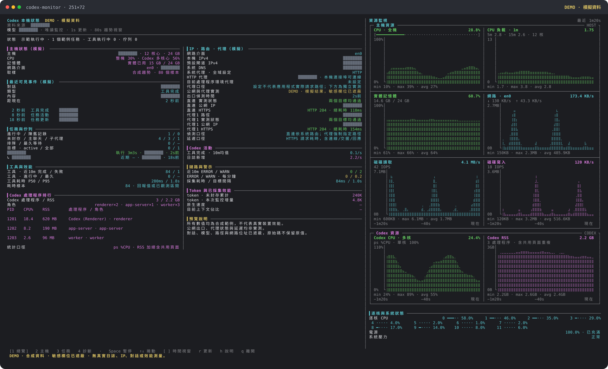

# codex-monitor

[简体中文](README.md) · [繁體中文](README.zh-TW.md) · [English](README.en.md) · [日本語](README.ja.md)

適用於 macOS 的唯讀本機 Codex 終端監控台：即時主機資源圖表、聊天與工具活動、程序資訊、網路設定，以及實際的 HTTPS 代理出口檢測。執行時不依賴第三方 npm 套件。本專案由社群獨立開發，與 OpenAI 無官方隸屬關係。



預覽使用**合成 DEMO 資料**。聊天名稱、模型、本機路徑、IP 位址、閘道、DNS、代理端點與訊息在繪製前已用不透明形狀遮蔽，SVG 原始碼不保留原值；曲線、狀態與耗時均為模擬，並非實測或真實帳號截圖。執行 `npm run demo` 可重建四種語言的預覽，`npm run demo -- --lang zh-TW` 則僅重建繁體中文預覽。

## 安裝與啟動

需要 **Node.js 24+**、**macOS** 與 **curl 8.7+**。完整主機採樣依賴系統內建的 `sysctl`、`top`、`vm_stat`、`memory_pressure`、`route`、`scutil`、`ioreg`、`pmset` 等工具。其他作業系統可能能取得部分基本指標，完整支援尚未驗證。

從 GitHub 安裝指令：

```sh
npm install --global git+https://github.com/Nemoyuzx/codex-monitor.git
codex-monitor
```

或複製儲存庫後在本機連結：

```sh
git clone https://github.com/Nemoyuzx/codex-monitor.git
cd codex-monitor
npm link --ignore-scripts
codex-monitor
```

安裝後可在任意目錄直接輸入 `codex-monitor`，預設進入每秒更新的互動模式，不必每次切換到專案目錄。

```sh
codex-monitor -i 3                  # 每 3 秒更新
codex-monitor --view diagnostics    # 開啟診斷頁
codex-monitor --once                # 單次文字輸出
codex-monitor --json --no-probes    # 單次 JSON，不連線至外部探測服務
codex-monitor -w --json              # 持續輸出 JSONL
```

開發測試另需 `openssl` 與監聽本機回送連接埠的權限。所有測試均使用暫存檔、記憶體資料庫或本機服務，不需要 Codex 帳號，也不依賴網際網路。Node.js 24/26 的自動測試設定見 [GitHub Actions](https://github.com/Nemoyuzx/codex-monitor/actions)。

目前沒有獨立桌面應用程式；指令需要終端與 Node.js 執行環境。SQLite 資料結構屬於 Codex 內部實作，後續版本可能變更，無法讀取的欄位會顯示為未知。

## 介面語言

支援簡體中文（`zh-CN`）、繁體中文（`zh-TW`）、English（`en`）與日本語（`ja`）。說明、參數錯誤、頁面標題、狀態提示及圖表標籤會隨所選語言切換：

```sh
codex-monitor --lang en                  # 英文
codex-monitor --lang=zh-TW                # 繁體中文
codex-monitor --language ja               # 日文；--language 是 --lang 的別名
CODEX_MONITOR_LANG=zh-CN codex-monitor    # 以環境變數指定簡體中文
codex-monitor --lang auto                 # 自動選擇（預設）
codex-monitor --help --lang en            # 英文說明
```

明確指定的 `--lang` 優先。自動選擇會依 `CODEX_MONITOR_LANG` → `LC_ALL` → `LC_MESSAGES` → `LANG`，取第一個非空且非 `auto` 的值；未設定或該值不受支援時，使用英文。相容 `en_US.UTF-8`、`zh-Hans`、`zh-Hant` 與 `ja-JP` 等系統語言標記；`C` / `POSIX` 使用英文。明確指定不受支援的語言會報錯，不會自行改用其他語言。

僅翻譯內建介面文字。聊天內容、標題、工具名稱、指令、原始日誌與系統回傳值保留原樣，JSON 欄位名稱與原始資料不隨介面語言改變。

## 用法

```sh
node codex-status.mjs                      # 單次輸出
node codex-status.mjs -w                   # 即時更新（預設每 1 秒）
node codex-status.mjs -w -i 3              # 每 3 秒更新
node codex-status.mjs --color              # 強制彩色（使用管線時也輸出顏色）
node codex-status.mjs --no-color           # 關閉顏色
node codex-status.mjs -w --view tasks      # 從任務頁啟動
node codex-status.mjs -w --window 300      # 最近 5 分鐘的趨勢
node codex-status.mjs -w --interface en0   # 固定網路介面
node codex-status.mjs --json --no-probes  # JSON 快照，關閉所有外部探測
node codex-status.mjs -w --json            # 持續輸出 JSONL
```

即時模式參考 nvitop 的終端配置，提供總覽、主機、任務與診斷四頁。右側顯示 8 張主機／Codex 趨勢圖，以及各核心 CPU、電源與系統壓力；任務、程序、工具、網路設定、警示與效能詳情位於左側。終端寬度達 180 欄時，左側自動分成兩欄，標頭固定，兩欄內文同步捲動。寬螢幕右欄約占 40%，其餘寬度留給左側資訊。

- 圖表填滿可用寬度，最新採樣位於最右側；缺失或尚未採集的資料留空。
- 圖表依可用高度放大，不會為文字清單壓縮；右側會保留各核心狀態的空間。較矮的視窗優先省略輔助文字，再縮小圖表高度。
- 預設時間範圍為最近 80 秒；`-i 3` 時為最近 4 分鐘，橫軸依實際採樣時間繪製。
- 實體記憶體採固定 0–100% 刻度，與 `memory_pressure` 的估計明確區分；整機及各核心 CPU 使用累計時間差值，Codex CPU 則為 `ps %CPU`（單核心 100%）。
- 預設網路介面跟隨系統預設路由，分別顯示上傳與下載。區塊裝置 I/O 包含已掛載的磁碟映像檔，不代表僅統計實體硬碟。
- 終端寬度不足 180 欄時，左側合併為單欄；不足 84 欄時隱藏右側圖表，8 項資源目前值仍可在文字詳情中查看。即時模式會為底部提示保留空間。
- `--window` 支援 10–3600 秒，`--threads` 支援 1–30 筆表格項目。表格筆數上限不會將背景統計限制在目前顯示的聊天。

## 快捷鍵

| 按鍵 | 操作 |
| --- | --- |
| `1` / `2` / `3` / `4` | 總覽／主機／任務／診斷 |
| 空白鍵 / `p` | 暫停或恢復採樣；暫停期間保留目前畫面 |
| `↑` / `↓`、`k` / `j` | 捲動左側完整內容，寬螢幕兩欄同步捲動 |
| `PgUp` / `PgDn`、`g` / `Home` | 向上／向下翻頁、回到頂端 |
| `[` / `]` | 縮短或擴大趨勢時間範圍 |
| `r` | 立即採樣，並更新探測結果與數值快照 |
| `h` / `?` | 說明 |
| `q` / `Ctrl-C` | 結束並還原終端 |

可透過 `CODEX_HOME` 指定資料目錄，預設為 `~/.codex`。

```sh
CODEX_HOME=/path/to/.codex node codex-status.mjs -w
```

## 監控項目

- **[1] 最近一次可見事件：**類型、內容、時間與距今時間，並附上最近的代理與使用者訊息。
- **[2] 尚未觀察到完成輸出的工具呼叫：**包含進行中的回合（turn）。
- **[3] 程序、MCP、佇列與目標：**app-server、exec-server、code-mode-host、可辨識的 MCP 子程序數、雲端佇列積壓與進行中目標。
- **[4] 網路探測：**本機 IPC、網路服務，以及 4 個後端端點的連通性。
- **[5] 儲存、日誌與用量：**累計 token、資料目錄／DB／WAL 大小、磁碟剩餘空間、日誌心跳與 ERROR 摘要。
- **[6] 目前狀態的保守判斷：**綜合以上可觀察訊號，提供紅／黃／綠分級。

右側趨勢圖與左側詳情包含：

- **主機：**整機與各核心 CPU、實體記憶體、記憶體壓力估計、所選介面的分方向流量、區塊裝置讀寫與 IOPS、分頁錯誤、swap、電池與系統壓力；圖表可顯示時間範圍內的最小／最大／平均值。
- **Codex：**依程序樹彙整 CPU／RSS，辨識桌面端、app-server、exec-server、code-mode、可辨識的 MCP 與工作程序，並顯示 CPU 排名。程序的指令參數中出現「codex」，不代表它就是 Codex 工作程序。RSS 加總會重複計入共用記憶體分頁。
- **任務：**主要聊天／子代理、模型、執行時間、最近活動、歷史遺留回合、佇列數與最長等待時間，以及實際處於 active 狀態的目標數。
- **工具：**近 10 分鐘／1 小時的完成與失敗數、工具類型、執行中項目，以及 P50／P95 耗時。完成速率依實際完成時間歸入統計範圍，顯示 10 分鐘平均值；失敗也計入總完成量。
- **診斷：**HTTP 狀態與回應標頭延遲、ERROR／WARN 每分鐘平均值、logger target 摘要、DB／WAL 大小、磁碟剩餘空間、採集耗時與來源可用性。HTTP 401／403 等回應僅能證明連線路徑可達，不代表登入有效或服務可用；MCP 數量本身也不視為資源洩漏的證據。
- **網路設定：**所選介面的本機 IPv4／IPv6、IPv4／IPv6 預設閘道、系統 DNS、HTTP／HTTPS／SOCKS 代理、PAC、自動探索與略過規則、目前程序的代理環境變數，以及偵測到的通道介面。總覽顯示摘要，診斷頁顯示完整詳情；存在通道介面不代表 VPN 已接管流量。
- **出口實測：**直連與各條明確指定代理的公網 IP、實際 HTTPS 連通性、HTTP 狀態與請求耗時。認證失敗、TCP／DNS／代理交握／TLS／逾時等情況分開顯示；僅部分目標可達時會明確標示。按 `4` 可查看各階段耗時與路徑驗證詳情。
- **Token：**資料庫累計計數及本次監控期間的計數增量，兩者都不代表模型生成速度。

## 選用的原生效能快照

若本機已有相容的 Codex Usage Badge `thread-metrics.sqlite`，監控台會唯讀查詢目前顯示聊天 UUID 的輸入／輸出數值、TTFT、快取命中及原生近似速度；也可透過 `--metrics-db PATH` 指定相容資料庫。介面僅顯示已接入的效能欄位及其採集時間，舊快照會標示為「快取」。

`≈tok/s` 僅接受帶有完整觀測中繼資料的原生採樣，不會從累計 token 或整輪耗時推算。未知的上下文比例、沒有可靠來源的 GPU／溫度及其他不可用指標均留空。不讀取登入憑證，也不啟動額外的原生事件監聽器。

## 公網出口與代理實測

透過系統 `curl`，分別對直連、系統 HTTP／HTTPS／SOCKS 及代理環境變數所指定的路徑發起 HTTPS 請求。相同端點／認證組合會去重，最多檢測 4 條代理；憑證僅透過子程序的標準輸入傳入，不會出現在參數、JSON 或日誌中。

- **[ipify 公網 IP 服務](https://www.ipify.org/)：**請求 `https://api.ipify.org?format=json`，僅在 HTTP 200 且回傳有效公網 IP 時顯示出口。
- **[HTTPS 連通性目標](https://www.gstatic.com/generate_204)：**僅在 HTTP 204 且回應為空時通過。與 IP 查詢分開顯示，避免將單一目標受限誤判為整個代理不可用。
- 明確指定代理的請求會強制經過該代理。探測會忽略略過規則，失敗時不會退回直連；HTTP CONNECT 與 SOCKS 路徑都檢測實際 HTTPS。保留 TLS 驗證，不將 403／407、重新導向、HTML 或不符預期的回應視為成功。相關行為見 [curl 代理說明](https://curl.se/docs/manpage.html#--proxy)及[略過規則說明](https://curl.se/docs/manpage.html#--noproxy)。
- 「直連（系統路由）」會停用應用層明確指定的代理，仍遵循系統 TUN／VPN 路由。兩條路徑可能使用相同公網出口，不能僅憑 IP 相同斷言未經代理。尚未解析的 PAC 指令碼會明確標示，不能當作已驗證路徑。
- DNS、TCP、TLS、首位元組及總耗時，均為從請求開始計算的累計時間，不是 ICMP ping 或純節點 RTT。介面保留實際測量時間；重新檢測時，舊結果會明確標示為上次結果。
- 外部實測同一時間僅執行一批，於背景進行並快取 60 秒，可按 `r` 更新。每批最多 10 個請求、4 個同時執行，單次請求逾時為 5 秒。單次文字與 JSON 輸出會等待整批有界結果；監控模式繼續更新，結束時會取消未完成請求。

這些請求僅連線至上述公開服務，不攜帶 Codex 聊天或本機狀態；`--no-probes` 會同時關閉公網 IP、代理 HTTPS 及原有 4 個 HTTP 探測。

## 實作要點

本機資料全部唯讀（SQLite 唯讀連線、設定檔讀取與程序／磁碟查詢），不修改 Codex 資料。預設會連線至 4 個應用端點及上述 2 個出口檢測服務，不上傳 Codex 本機資料；`--no-probes` 可關閉所有外部請求。

- 4 個應用 HTTP 探測在背景執行，結果快取 10 秒；公網與代理 HTTPS 實測快取 60 秒，每秒更新畫面不會每次都重發請求。
- 網路設定快取 10 秒，可按 `r` 強制更新。設定採樣保留本機代理連接埠的 TCP 監聽狀態，實際代理可用性由獨立 HTTPS 實測判定；系統設定、監聽狀態或獨立探測，不等同於 Codex 應用程式本身的請求路徑。
- 代理環境變數與 PAC 位址僅顯示協定、主機與連接埠，不顯示認證資訊、路徑或查詢參數。`NO_PROXY` 僅顯示略過規則數量。
- 資料目錄大小（`du`）僅採集一次；每次採樣共用一次完整的 `ps` 程序採集。
- 每 5 秒重新檢查資料庫來源，啟動後新建的資料庫、版本輪替與檔案替換可自動接入；按 `r` 會立即重新探索來源並讀取設定。連線始終唯讀，來源不可用時保持空值。
- 活動統計在單次採樣內重用預備 SQL 陳述式；資料表結構變更會使欄位快取失效。近期回合查詢可利用來源資料庫既有的時間索引，不會在來源資料庫建立索引。
- 預設網路介面透過獨立的 1 秒快取跟隨路由；無法確認預設出口時保持未知，不依累計流量猜測。探測執行期間的更新要求會合併成一次後續請求。
- 結束時會取消尚未完成的 `top` 採樣；缺失、重設或來源變更的速率基準不會被當作零速率。任務名稱中的複合 emoji 會以完整字元截斷及換行。
- 時間戳記依各自單位換算：`threads.updated_at_ms`／`thread_items.*_at_ms` 為毫秒，`thread_turns.started_at`／`logs.ts` 為秒。
- 工具統計涵蓋近一小時內更新的聊天與所有候選進行中回合，最多 256 個聊天、每個聊天 10000 筆投影資料；耗時百分位採用最多 2000 個具有實際耗時的已採樣完成項目。查詢結果至少快取 5 秒，達到上限會顯示「有界採樣」與 `≥`，不能據此聲稱所有工具均無異常。
- SQL 查詢失敗或資料來源缺失時，會顯示不可用與空值，不將讀取失敗當作零占用、零警示或健康。歷史未完成項目會獨立列出，不能僅憑「超過 1 小時」斷言已停止。
- JSON／JSONL 輸出包含資源數值、聊天中繼資料與數值統計，不包含訊息、工具指令參數、日誌內文或身分憑證。
- 即時模式在結束或採集異常時，會還原原有 raw mode、自動換行、游標與替代螢幕；非 TTY／JSONL 輸出不會傳送螢幕控制序列。

執行全部驗證：

```sh
npm run check
npm test
```

## 隱私與分享

終端頁面可能顯示本機聊天片段；JSON 雖省略訊息與指令內文，仍包含聊天標題／暱稱、UUID、模型、IP 位址及代理端點等中繼資料。分享截圖或匯出檔案前，請先檢查並遮蔽敏感資訊。請勿提交實際 Codex 資料庫、認證檔案、私人聊天截圖或網路封包擷取檔。

## 貢獻與授權

歡迎[回報問題](https://github.com/Nemoyuzx/codex-monitor/issues)與提出聚焦的改進，開發約定見 [CONTRIBUTING.md](CONTRIBUTING.md)。本專案採用 [MIT License](LICENSE)。

介面參考：[nvitop 官方主機面板](https://github.com/XuehaiPan/nvitop/blob/main/nvitop/tui/screens/main/panels/host.py)。
